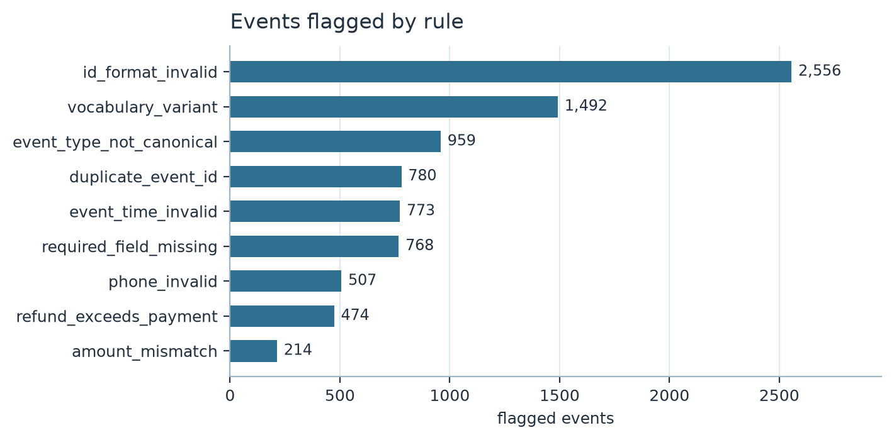
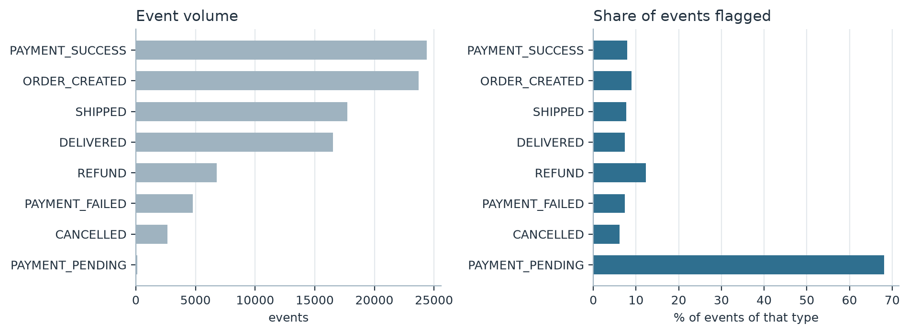

# Huang Yudan

I am a data science student at the University of Macau. I like taking messy, real-world
data and turning it into something that can be checked: a rule, a test, a chart that either
supports a claim or does not. My current interest is **data quality** - the unglamorous
work of deciding whether the numbers you are about to analyse can be trusted at all.

- **Email:** hyd9378594@163.com
- **GitHub:** [@Yudan-Huang](https://github.com/Yudan-Huang)

---

## Technical skills

| Area | Tools I use |
| --- | --- |
| Data wrangling | Python, pandas, NumPy |
| Validation and testing | rule-based validation, pytest, reproducible pipelines |
| Visualisation | matplotlib |
| Querying | SQL, pandas |
| Working with scale | chunked CSV processing, grouped transforms |

---

## Project showcase

### Auditing a 9.85-million-row e-commerce event log

**Research question.** Which rows in an order-event log are defective, and what kind of
defect is each one?

An order-event log records every step of an online sale: order created, paid, shipped,
delivered, refunded. Revenue reporting and fulfilment both assume that log is clean. I
built a nine-rule audit over 18 columns and 9.85 million events to find the rows that
break it.

**What the chart shows.** Roughly three quarters of all flags are *formatting* problems -
identifiers that do not match the `EV` + 12 digits pattern, vocabulary variants such as
`Paid` instead of `PAYMENT_SUCCESS`, and event labels outside the eight allowed types.
Arithmetic inconsistency is the rarest category. The log does not mainly mis-state money;
it mis-spells things.

**Why it matters.** Once labels are normalised, defect rates sit between 5% and 13%. But
every row carrying a hand-typed label - `ORDER CREATED`, `Delivery Complete`, `已签收` - is
defective by construction. The defect is not spread evenly: it concentrates wherever a
human typed the vocabulary instead of a system emitting it.

Across the full log, 13.49% of events were defective, and my course submission of this
analysis reached a **precision of 96.01% and a recall of 93.34% (F1 94.66)** on the course
evaluator. The public repository is a cleaned-up nine-rule version of the same pipeline,
written so that each rule can be read and tested on its own.

- **Repository:** [data-science-project](https://github.com/Yudan-Huang/data-science-project)
- **Status:** completed
- **Reproducible:** `README.md` documents the exact commands; a synthetic data generator is
  included so the pipeline runs without the restricted dataset.

---

## What I am working on next

Adding an order-level evidence graph, so that rules can reason about conditions that span
several events of the same order - the part of the specification my current row-local rules
handle least well.

---

*Built with GitHub Pages. Last updated: October 2026.*
